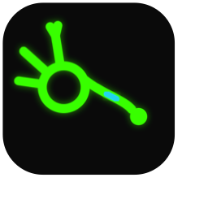

# agent-neuron



Any program (a shell script, a Python file, a model call) goes inside the same wrapper, a JSON stdin/stdout contract, so they can be wired together in any shape. Instead of a central controller deciding what runs, each wrapper carries its own rules: how many inputs must agree before it acts, when work has gone stale and gets cut, how much it may spend.

This is an experiment at concept stage: a specification (version 0.1, draft), three engines — the TypeScript reference, a protocol test in Python and a complete second engine in Rust — and a set of demos. Nothing is on npm yet.

The idea as a protocol, for agent and framework developers: [docs/WHITEPAPER.md](docs/WHITEPAPER.md) (a draft).

## A team decides how its agents run

The strongest pattern in coding agents right now is one developer with a harness. The failure mode when a
team shares that harness is well known: plausible agent contributions that no rule was in a position to
stop (slop grenades), and architectural choices made silently inside a diff (invisible lock-ins). Both
come from the rules travelling as private prompt context. agent-neuron makes the coordination layer a
network whose rules are data the whole team can see, argue with and version in git:

- the work lands as **desk items** — every ask rides whole, on a page several people share, each person's
  items filtered to their role;
- **`threshold` decides quorum** (two reviewers agree on the direction), **a human gate decides the
  irreversible step** (a merge as an `effect`: never cut, `unknown` on crash), and **budgets bound what
  any agent may spend**;
- every vote, accept and refusal lands as one auditable line, with the trace beside it showing which rule
  fired — the decision record no harness keeps;
- **agents join through MCP** (`neuron-engine mcp`: `check_network`, `run_network`, runs as jobs,
  live resources), **people answer on the page**. Specs and guidelines ride as data the network names,
  so the team's policy is a diffable file in git — and a spec change is itself a decided contribution
  on the same surface.

It runs today as a demo, with no model anywhere:

```sh
npm run demo:team
```

Two agent contributions sit on real branches of a scratch git repo. Two reviewers vote in their browser
windows; the quorum settles the direction; a lead gates the merge; the merge is a real git commit with a
tag, and the ledger of who decided what is on every page. Two scripted paths (`--headless`,
`--headless --tie`) show the whole flow — quorum and tiebreak — without browsers. The full positioning,
and the four protocol gaps this surface is driving (grants at the desk, durable holds, presence,
quiescence): [docs/MULTIPLAYER.md](docs/MULTIPLAYER.md).

## What's built, what's planned

| Built | Planned |
|---|---|
| A shared decision surface: desk items for several people, quorum by `threshold`, a lead's gate on an `effect`, the merge a real git commit (`npm run demo:team`) | Grants validated at the desk's POST, a `human` hold that survives a restart, presence, run quiescence ([issue #30](https://github.com/overfocus/agent-neuron/issues/30)) |
| Wrapper for scripts, executables, HTTP APIs and a human on stdin (`src/adapters/`); `human` neurons in network files, answered on a local page (`npm run demo:human`) | A network that rewires itself; durable trails between runs ([issue #30](https://github.com/overfocus/agent-neuron/issues/30) item 1) |
| Many-to-many links, broadcast or targeted signals, each signal tracing its chain; trail strength as engine state: `ground` — deposits kept per place, evaporation, a seeded one-link routing for replies that name no `to` ([decision 0012](docs/decisions/0012-the-ground.md)) | Ignore conditions, passive and active channels |
| Per-neuron `threshold` (N distinct senders must agree), `within`, `replaces` (a newer input cuts stale work) and `maxHops` (loops stop) | Limits other than `maxHops` |
| Network files: a JSON format, a closed schema, a validator and a reference engine that runs them (`npm run engine`) | A `human` wait that survives a restart |
| Per-trace budgets, effects that are never cut, a live event stream | A neuron reporting its own spend |
| A second complete engine in Rust (`rust-engine/`): real processes, `http` neurons (from a network file), `human` neurons on the desk, the MCP server `neuron-engine mcp` | `https` (needs a dependency policy) and packaging of the engine binary for npm |
| Composed neurons: a whole network behind one wrapper, sealed from outside | Anything that learns: today each call is its own process and nothing is kept |
| 246 conformance fixtures any other engine must pass (decisions 0012, 0016's `may` and 0019's neuron file included); recorded traces; a local page that draws a run | A real model: no model is called anywhere, every "model" in the demos is a timed stand-in |

## Try it

You need Node 22 or later. You do not need Rust for this one (the Rust engine's tests, the two Rust demos and `npm run check` do), and it makes no network requests. Run it on macOS or Linux.

```sh
git clone https://github.com/overfocus/agent-neuron && cd agent-neuron
npm install
npm run demo:network
```

Output (a run takes about 7 seconds; the counts vary a little with machine load):

```
Alert storm from alerts.network.json: 40 alerts over 5.6 s, run by the engine.
40 alerts -> 52 flags -> 17 hypothesis calls instead of 40
10 calls cut short as stale, 11 waiting flags replaced, 7 gave up waiting
7 diagnoses; the last: {"alert":35,"service":"checkout","detectors":["deploys","logs"],"root":"gateway","deploy":"dep-8b21","minutes":14}
321 events in the trace; no inner id of diagnosis in it: true
```

A live run on real processes varies slightly from run to run (17 or 16 calls, say); the fixed numbers quoted elsewhere come from the recorded trace, `traces/alerts.json`.

That is a made-up storm of 40 alerts for five services. Cheap detectors flag alerts, a slow neuron stands in for a model call (a 500 ms timer) and runs only when two detectors agree, and a composed neuron answers with a diagnosis. The summary says 17 slow calls ran instead of 40.

### The network file

The whole storm is this file, `spec/examples/alerts.network.json`. The programs it names are in `spec/examples/neurons/` and `examples/alerts/`.

```json
{
  "$schema": "../network.schema.json",
  "version": 0,
  "name": "alerts",
  "description": "Alert storm triage: cheap detectors flag alerts, a slow neuron runs only when two detectors agree, a composed neuron finds the root cause.",
  "neurons": [
    { "id": "alerts", "description": "Where alerts enter. The producer tags each with a replaces key (its service).", "source": true },
    { "id": "logs", "description": "Flags an alert when the log has error lines for its service.", "run": ["sh", "../../examples/alerts/detect-logs.sh", "../../examples/alerts/logs.txt"] },
    { "id": "deploys", "description": "Flags an alert when its service was deployed in the last 30 minutes.", "run": ["sh", "../../examples/alerts/detect-deploys.sh", "../../examples/alerts/deploys.txt"] },
    { "id": "metrics", "description": "Flags a critical alert when the service's error rate is above 5%.", "run": ["node", "neurons/metrics.mjs"] },
    { "id": "hypothesis", "description": "A 500 ms stand-in for a model call; acts once two distinct detectors flag one alert.", "run": ["node", "neurons/hypothesis.mjs", "500"], "threshold": 2, "within": 500 },
    { "id": "diagnosis", "description": "Composed: finds the root cause and the deploy to look at.", "network": "diagnosis.network.json" }
  ],
  "links": [
    { "from": "alerts", "to": "logs" },
    { "from": "alerts", "to": "deploys" },
    { "from": "alerts", "to": "metrics" },
    { "from": "logs", "to": "hypothesis" },
    { "from": "deploys", "to": "hypothesis" },
    { "from": "metrics", "to": "hypothesis" },
    { "from": "hypothesis", "to": "diagnosis" }
  ]
}
```

`hypothesis` has `threshold: 2` and `within: 500`: it acts only when two distinct senders (here `logs`, `deploys` and `metrics` are the candidates) have each flagged the same alert, and a flag that waits longer than 500 ms for a partner is dropped. `replaces` is not in the file: the producer puts it on each input (here, the alert's service), and a newer input with the same key cuts older work for that key that is still waiting or running, which is where the "cut short as stale" and "replaced" counts come from. Edit the file, run `npm run engine -- check spec/examples/alerts.network.json` to validate it, and run it again.

## How it compares

- **Unix pipes.** A level-0 neuron is a filter: a program that reads JSON on stdin and writes JSON on stdout. The difference is that neurons form a graph (many in, many out, loops allowed and bounded), not a line.
- **Node-RED and similar flow files.** The shape is similar: a JSON file lists nodes and links. The difference I am trying for is that each node carries its own firing rules (threshold, staleness, budget, effect), and that those rules have a written specification and conformance fixtures, so another engine can be checked against the first. That has now happened three times: the TypeScript reference, a Python protocol test, and a complete Rust engine — all three pass the same 246 fixtures (the 21 of decision 0012, the 7 of decision 0016's `may` and the 14 of decision 0019's neuron file included).
- **Agent frameworks.** They usually put a controller or planner in the middle. Here nothing in the middle decides; and no model is required, since a neuron can be any program. And the top-level deciding can belong to the team: quorum, gates and budgets are neuron fields, so three people agreeing on a merge is the same graph that triages forty alerts by itself (`npm run demo:team`).

I have not benchmarked any of these against it, and this one is far smaller and younger than all of them.

## The idea

- **Wrap anything.** A neuron can hold an LLM-powered agent, plain code with
  no AI in it, an external program, or a human answering through the same
  interface. The wrapper is an adapter: it translates between the neuron
  network and whatever the thing inside expects.
- **No model required.** The network runs on a deterministic engine, so
  neurons can execute without a model. AI is something a neuron *can* hold,
  not something the network depends on.
- **Many-to-many connections.** Every connection can be bidirectional. A
  neuron can also be told to ignore input from a connection when other
  conditions hold.
- **Adaptive (the trail is built; habits between runs are planned).** The
  ground ([decision 0012](docs/decisions/0012-the-ground.md)) keeps strength
  per place, evaporates it, and routes replies that name no `to` by a seeded
  draw — the colony demo runs on it. What is still planned: carry-over
  between runs, so a network brings its trails with it, and a network that
  rewires itself.
- **Simple at the core.** The neuron interface is most valuable the simpler
  it is: wrapping something should stay a few lines, whatever the network
  learns to do around it.
- **Configured at the wrapper.** How a neuron listens, when it stops and what
  counts as done are set on each neuron's wrapper, not by a central
  controller.

Where it could be useful, ranked honestly by fit: [docs/USE-CASES.md](docs/USE-CASES.md).

The network file format, the neuron contract and the routing rule are
specified in [docs/SPEC.md](docs/SPEC.md) (version 0.1, draft).

## Why "neuron"

The name is a loose analogy, not a model of biology. A neuron here stands for
connective tissue between arbitrary functions and agents: the part that
decides what is connected to what and what flows between them. The in-run
part of how strongly things are connected is built (`ground`,
[decision 0012](docs/decisions/0012-the-ground.md)); the part that keeps
habits between runs is still planned.

## What the wrapper gives what's inside it

- **Query and answer:** a simple way to ask a neuron something and get an
  answer back.
- **Channels, passive and active:** a neuron can broadcast to every neuron,
  or target one neuron or a set of neurons.

## Signals

Signals start as **free text or JSON**. More data types are expected later;
which ones, and how a wrapper converts between them and what its contents
expect, is one of the things to experiment with.

Every signal has an `id` and a `trace`, the id of the first signal of its
chain. An answer from `send` or `emit` has `replyTo`, the id of the signal it
answers, and shares that signal's `trace`. Outside code that passes an answer
on gives the next `send` or `emit` `{ cause: answer }`: the new signal records
`cause` (the answer's id) and joins its trace. Nothing passes answers on by
itself yet, and the network does not store signals; keep a map by id if you
need to look one up.

## Many inputs, one neuron

When a neuron has many incoming connections, how it responds is an option
set per neuron. By default it acts on each input as it arrives. Two more ways
are expected: combining all inputs into one picture before acting, and
weighing senders differently. One is built:

**Threshold.** `new Neuron(id, adapter, { threshold: 2, within: 5000 })` acts
only when two distinct senders have each sent it an input on the same trace
(inputs in different traces never combine). The adapter then runs once, and
`context.inputs` holds the inputs that met the threshold, the one that
crossed it last. Details:

- Each sender counts once; its newer input replaces its older one (the older
  is reported as `onDrop(..., 'replaced')`).
- Held inputs get no answer of their own, and no drop once consumed, even if
  the run is aborted or fails. The run's answer is for the input that crossed
  the threshold.
- A running call is cut when any input it acted on is replaced by a newer emit
  (same sender, same `replaces` key), not only the one that crossed: its adapter
  is aborted and `onDrop(crossingInput, id, 'replaced')` is reported once. The
  other inputs report nothing. The trace tells it from a held input's drop by
  `phase` (`running` or `waiting`) in new recordings (the committed traces predate it).
- An input still held after `within` ms (default 10000) is dropped with
  `onDrop(..., 'expired')`. An input whose `emit` is replaced (same `replaces`
  key, newer emit) is dropped as `'replaced'` and stops counting.
- It applies to `emit`. `send` is a direct exchange, like `Neuron.query`, so it
  skips the threshold and runs the adapter at once, without `context.inputs`.
- `idle()` does not wait for held inputs: they are waiting, not working, and
  waiting 10 s for them would help nobody. Their timers do not keep the process
  alive, so a program that exits first never sees the `'expired'` drop.
- Once a trace has acted, a later input on it starts a new hold.
- Without `threshold` nothing is held and no timer is made.

Run `npm run demo:suggest` to watch one.

## Loops and finishing

Connections can form loops, so something has to stop a network from running
forever, and something has to say when it has an answer. Both are configured
per wrapper: each neuron carries its own limits and its own idea of done,
rather than the network having one global rule.

The first limit is built: every signal carries `hops`, its place in its chain
(0 for a root, one more than the signal it answers or follows through
`replyTo` or `cause`). A neuron created with `new Neuron(id, adapter, { maxHops: 3 })`
refuses a signal with more than 3 hops: `emit` reports it through
`onDrop(signal, id, 'hops')` and the adapter never runs, and a waiting `send`
leaves that neuron's answer out. Without `maxHops` there is no limit.
A refused signal is still reported to `onSignal` (refusal is per neuron, and on a broadcast others may accept it), and `send` leaves the refusing neuron's answer out without an `onDrop`. `Neuron.query` is a direct ask and skips it. Hops only count along a trace:
code that passes an answer on without `{ cause }` starts a new trace at 0, so
forward with `cause` if you want the limit to see the loop. The idiom: an answerer passes its answer on with `network.emit(answer.from, answer.payload, { to: answer.to, cause: answer })`. Run
`npm run demo:loop` to watch one being cut.

## Composition

A network of neurons is itself a piece of software, so it can be wrapped as
a neuron. Neurons compose: a neuron can contain a whole network, and from
outside it looks and behaves like any other neuron.

The wrapper of a composed neuron is a **boundary**. It works like a force
field: the neurons inside it cannot be reached from outside. Other neurons
connect to the composed neuron, never to what is inside it, and everything
that crosses the boundary goes through the composed neuron's own interface.

- **Sealed both ways.** Neurons inside cannot reach out past the boundary
  either; whatever leaves goes out through the composed neuron.
- **Traceable from inside only.** A signal can be traced through the
  neurons inside, but only from within the composed neuron. From outside,
  the trace shows a signal going in and an answer coming out.
- **Learning stays inside (planned).** The intent is that connections that
  strengthen inside a composed neuron stay inside it, and what shows outside
  is the result.
- **Each use learns on its own (planned).** The same composed network used in
  two places would become two neurons that learn separately.

The first working example is `npm run demo:composed`: a Rust program
`music` with a tiny inner network (tracks, artist and lyrics neurons) that
the outer network sees as one neuron. The boundary is sealed by
construction: `music` is a separate process, its inner handlers can only
return text, and the outer network has no way to name an inner neuron (a
test checks that no inner id appears outside). The trace exists inside
only: the outer signals are one request and one answer, while
`music --inspect` run on its own prints the inner signals. Running it
standalone is looking inside, not the outer network reaching in. It does
not show learning, which does not exist yet: each call is its own process,
so "each use learns on its own" holds only because nothing is kept.

## Run a network file

A network can be a file instead of code: neurons, one-way links, thresholds,
and each neuron's program as a command. The reference engine (`src/engine/`,
also importable as `agent-neuron/engine`) reads it, with no caller code:

```sh
npm run engine -- check spec/examples/alerts.network.json
npm run engine -- run spec/examples/alerts.network.json \
  --inputs spec/examples/alerts.inputs.jsonl --trace storm.json
npm run demo:network        # the alert storm from its file, summarised from the trace
```

`check` validates the file against the schema and reports what a schema cannot
(unknown ids with a "did you mean", a missing composed file, a cycle without
`maxHops`, a budget or cost that is not a whole number or names an unknown unit), with line and column. `run` injects the timed inputs into the
file's sources (one JSON object per line: `at` in ms, `source`, `payload`,
optional `replaces`, optional `budget` to lower that trace's budget), runs every neuron as a process, forwards answers along
links, and writes a [trace](docs/TRACE.md) that the replay module and the
network view read. A neuron is any program: `spec/examples/neurons/` has the
same `hypothesis` neuron in JavaScript and in Python, and
`alerts-python.network.json` swaps one for the other. A neuron can also be one
long-lived process speaking JSON lines (`"serve"`, level 1): the engine starts it
once, matches replies to calls, sends it `cancel` for stale work, pings it, and
restarts it with backoff if it dies. `hypothesis_serve.py` is that neuron in 29
lines of standard-library Python, and `alerts-python-serve.network.json` runs the
storm with it (`npm run demo:network -- spec/examples/alerts-python-serve.network.json`).
This engine runs `source`, level 0 (`run`), level 1 (`serve`) and composed
(`network`) neurons; the rest of the
[specification](docs/SPEC.md) (version 0.1, draft) and the gaps are in its
Appendix C.

### Budgets

A network file may declare a `budget` (named units, whole numbers) and give a neuron a
`cost`. Each trace gets its own pool: a call reserves its cost when it starts, a call that the
pool cannot cover is refused with an `error` of code `budget`, and every call that started consumes
what it reserved, whether it answered, was cut or crashed. A composed neuron's cost caps its inside.
Under a budget every neuron but a source declares a cost (0 is allowed), so nothing spends unseen. The trace shows it all (`reserve` and `commit` notes with the time the engine measured, and one
`finished` event per trace with what is left), and a producer may lower a trace's budget when it
injects, never raise it. A network with no budget works as before, bar the `finished` events. See
[SPEC section 10](docs/SPEC.md) and [decision 0006](docs/decisions/0006-budgets.md).

```sh
npm run demo:network -- spec/examples/alerts-budget.network.json   # the storm with 12 credits an alert
```

### Effects and the live stream

A neuron that does something in the world is declared `"effect": true`. A newer input never cuts a
call that has started (nothing is cancelled, its answer is recorded, its cost committed), it only keeps
that answer from being forwarded (`"forwarded": false` on the `answer` event); and if the call crashes, hangs
or times out, the trace says `unknown`, not `error`, because nobody can tell whether the effect
happened. The engine reconciles nothing: a producer or an observer injects the id from the payload into a
declared source (SPEC 11.4). Every event is also offered as it happens, in written order, to a library
callback (`onEvent`) and as JSON lines (`run --stream <path>`); a consumer that fails never changes the run
(SPEC 9.1). See [SPEC section 11](docs/SPEC.md) and [decision 0007](docs/decisions/0007-effects-and-the-live-stream.md).

```sh
npm run demo:notify   # a notification that a newer build update does not cancel, and a crash recorded as unknown
npm run demo:human    # a person approves, edits or refuses each proposed rewrite on a local page
```

### Conformance fixtures

Any further engine must give the same events as this one on
the same inputs (the first Rust attempt was tried and stopped:
[decision 0005](docs/decisions/0005-rust-engine-experiment.md); the engine now on
`main` restarted from the text under the same terms —
[decision 0009](docs/decisions/0009-rust-engine.md), covered below). The shared test is [`spec/fixtures/`](spec/fixtures/): 246
small fixtures, each a network file, scripted inputs, scripted neuron replies with
latencies on a virtual clock, and the exact events expected, ids normalised. No
process starts and no clock is read, so a run is exactly repeatable.

```sh
npm run engine -- conform spec/fixtures   # pass or fail per fixture; non-zero exit on a failure
```

The format and the command-line contract any engine implements are in
[docs/CONFORMANCE.md](docs/CONFORMANCE.md). None is pending; the fixtures under `budget/` pin the budget
of version 0.1 and the `finished` event, `effect/` the effect option and the `unknown` outcome, `stream/` the live stream, and
`ground/` the trail layer ([decision 0012](docs/decisions/0012-the-ground.md): deposits, ageing, the seeded draw), and
`neuronfile/` a neuron described in a file of its own, which the network that names it may only narrow ([decision 0019](docs/decisions/0019-the-neuron-file.md)), and
`may/` what a neuron's program is declared to touch ([decision 0016](docs/decisions/0016-the-self-describing-neuron.md): checked by every engine; the Rust engine holds a program to it on macOS when a run asks with `--confine`, [decision 0018](docs/decisions/0018-confining-a-program-to-its-may.md)).

#### A second engine, in Python

[`py/`](py/) holds an engine written from the specification and the fixtures alone, in Python 3.11 or later with the standard
library only (no `pip install`), to test whether the specification is a protocol and not just the TypeScript code. It reads
the same network files and fixtures and implements the command-line contract of CONFORMANCE section 8. It has no process
layer: it runs scripted programs on the virtual clock, as the fixtures require, and refuses `http` and `human` neurons (it has no scripted person yet).

```sh
npm run conformance:py                                        # all of spec/fixtures; pass or fail per fixture, then the totals
PYTHONPATH=py python3 -m agent_neuron conform spec/fixtures --only staleness/   # a subset
PYTHONPATH=py python3 -m agent_neuron conform py/probes       # extra fixtures, which the TypeScript engine also passes
```

What it passed, what the specification left open and where the two engines differ: [docs/conformance-python.md](docs/conformance-python.md).

#### The second complete engine, in Rust

[`rust-engine/`](rust-engine/) is the engine the fixtures were asking for: written from [SPEC](docs/SPEC.md), [CONFORMANCE](docs/CONFORMANCE.md), the network schema and the fixtures alone (the TypeScript engine was used as a black box), in Rust with the standard library only (a one-package `Cargo.lock`, nothing fetched). It is the only engine so far that runs a real network end to end: the process layer (level 0 `run`, level 1 `serve`, pings, restart backoff, SIGTERM then SIGKILL after the kill grace with the 6.3 notes), real `http` neurons (`https` is refused honestly — no TLS in a std-only crate), `human` neurons answered on the desk of Appendix D ([decision 0008](docs/decisions/0008-human-neurons-on-a-page.md)), budgets, effects and the live stream. It carries the family's MCP surface: `neuron-engine mcp` speaks JSON-RPC 2.0 over stdio with `check_network`, `describe_network` (the shape of a network file tree, composed networks inside, for drawing it before any traffic), `run_network`, `start_run`/`poll_run` (a run as a job, with live `run://{id}` resources and notifications) and `read_trace`, and serves SPEC, CONFORMANCE, TRACE and the schema as embedded `spec://` resources. `conform`, the fixtures and human networks are deliberately unexposed there: the desk is the person's surface, not an MCP surface. Every trace it writes declares its ids scheme in the header (`{"signal":"run-numbered","trace":"run-numbered"}` — ids are opaque strings, compared, never parsed, per [TRACE.md](docs/TRACE.md)). P0 of the peer layer is built ([decision 0013](docs/decisions/0013-p2p.md)): `run --peers <file>` names the machines that execute some of the network's `run` neurons, and `neuron-engine peer` is the worker. A dispatched call runs the same level 0 contract on the peer and comes back through the engine's queue, so the run is the run a local one is — same answers, same events, wall-clock stamps aside. It is the seam, not yet the protocol: placement covers `run` neurons and whole networks, and cancel, `serve`, the ground and quiescence are P1–P4 in [docs/P2P.md](docs/P2P.md). A peer can also *be* one neuron whose inside is a network (`peer --network <file>`), which is the composability Kevin asked for: an outer run places a `network` node on a peer and composes with it exactly as with a composed neuron planted locally, down to the `inner` error and the sealing — and the hosted graph can itself place its nodes on other peers. `npm run demo:p2p` launches four peer engines and a driver from this repo and prints the answer, the trace and where the run lives: `classify` on one engine forwards to `review` on the next, whose `wrap` runs on a third and whose `audit` — a whole network — runs on a fourth.

```sh
cargo test --manifest-path rust-engine/Cargo.toml                            # 123 tests, 0 failed
cargo run --manifest-path rust-engine/Cargo.toml -- conform spec/fixtures    # 224 passed, 0 failed, 0 pending
cargo run --manifest-path rust-engine/Cargo.toml -- conform py/probes        # 10 passed, 0 failed, 0 pending
cargo run --manifest-path rust-engine/Cargo.toml -- mcp                      # the MCP server on stdio
cargo run --manifest-path rust-engine/Cargo.toml -- run net.json --inputs in.jsonl --peers peers.json  # some calls run on another machine (P0, decision 0013)
cargo run --manifest-path rust-engine/Cargo.toml -- peer --listen 127.0.0.1:7301 --token <hex>   # the worker that side of the wire
npm run demo:p2p                                                             # four engines, three graphs, one answer: the composability demo
```

Gates, standing rules (black-box engines, rustfmt at 140, clippy `-D warnings`) and the size tables: [rust-engine/README.md](rust-engine/README.md). The direction record — why a second engine, what complete means against the first attempt's no-go, and the gates rerun on merged `main` — is [decision 0009](docs/decisions/0009-rust-engine.md). The voice-rewrite tool timbre runs this engine as one built binary: the dependency is a binary, not a package.

## The first example

Three neurons wrapping three very different things:

- **a website with an API**, wrapped so its requests and responses become
  signals;
- **a shell script**, wrapped so its input and output become signals (a
  failed exit is reported as an error);
- **a program waiting for a human response**, wrapped so a person is a
  neuron like any other.

If those three can be connected and exchange signals through the same
interface, the wrapper idea works.

## A second example (planned)

A search box on a music site, run as a network of neurons in real time:

- **the search box** is a neuron. As someone types, it broadcasts each
  keystroke, or the query so far, to every neuron it is connected to;
- **music search** acts once there are a few characters and returns tracks;
- **artist** acts only when the text matches an artist it knows;
- **lyrics** acts when the text looks like a line from a song rather than a
  name;
- **concerts** listens to the artist neuron, not to the box, and acts once
  an artist has been named;
- **links** turns any result into links for each streaming service.

Every neuron hears every keystroke; each one's wrapper decides whether the
input is worth acting on. Nothing in the middle decides for them. The example
will use a made-up catalogue.

It needs three things the first example does not have. Two are built: a send
that does not wait for answers (`emit`) and a way to drop work made stale by
a newer keystroke (`replaces`), shown in a terminal demo,
`npm run demo:typing`. Still missing: a page to watch it happen on. It is
also a test bed for the open questions below: keystrokes are a candidate for passive traffic, the concerts neuron is a
chain inside the network rather than routing by outside code, and the
results a person clicks are a candidate signal for strengthening a
connection.

## Open questions

All of these are up for debate; experiments should inform them.

**Connections**

- What counts as a connection being useful, and who decides: any traffic
  across it, an answer that came back without an error, or a rating from the
  sender, the receiver, or an observer (possibly a human)?
- What does strength change: whether a broadcast reaches a weak link at all,
  how much a link's input counts toward a threshold, or the order links are
  tried in?
- Is strength one number per pair of neurons, one per direction, or each
  neuron's private rating of its neighbours?
- What happens to a weak connection: it loses priority, it is muted and can
  recover, or it is cut and the network tries new ones?
- Where do strengths live between runs: in a file that can be read and
  edited, or in each neuron's wrapper configuration, so a neuron brings its
  habits with it?

**Channels**

- What is a passive channel, as opposed to an active one: a send that does
  not wait for an answer, something the receiver pulls or subscribes to, or
  a signal that is noted without making the neuron act?
- Is passive or active set on the connection, on the neuron, or by the
  sender for each signal?
- Does passive traffic count toward strength and loop limits?

**Composition**

- How does a composed neuron's learning show outside: only in better
  answers, or also as something its neighbours can see, such as a stronger
  connection to it or a capability it declares?

**Flow**

- When a neuron answers, who decides where the answer goes next: code
  outside the network, the neuron's wrapper (forwarding to some or all of its
  connections), or only back to whoever asked?
- When one neuron reaches its idea of done, does the whole run stop, does
  only that neuron go quiet, or is the caller told and left to decide?
- Do neurons run in one program, as separate local processes, or across
  machines?

## Status

The first example works: shell, HTTP and human adapters, neurons with
bidirectional links, and a network that broadcasts or targets signals
(`src/`). A send that does not wait for answers (`emit`) can replace older work from
the same sender, and adapters stop when it is dropped. A neuron can wait for a `threshold` of distinct senders on one trace (`npm run demo:suggest`); its running call is cut when any input it acted on is replaced. An alert storm demo (`npm run demo:alerts`) puts threshold, stale-work dropping, wrapped scripts and a composed diagnosis neuron together. The trail layer
(`ground`, [decision 0012](docs/decisions/0012-the-ground.md)) is built; carry-over between runs, rewiring, ignore conditions, limits other than `maxHops`, and passive/active channels are not
built yet. Every signal carries a `trace` shared by everything it leads to;
answers record the signal they answer (`replyTo`), and `send` and `emit` take
an optional `cause` to continue a trace. Nothing passes answers on by itself,
and the network keeps no store of past signals. Listeners for `emit` work (`onSignal`, `onError`, `onDrop`) are
called safely: if one throws, the error is swallowed. A small Rust program also runs as a neuron through the shell adapter (`npm run demo:rust`), showing the wrapper is not tied to one language. A local page draws any of three demos live as they run (`npm run view`). The team demo (`npm run demo:team`) runs the same engine's desk as a shared decision surface for three people over real git branches, the merge among them an effect — the multiplayer protocol pieces around it (grants at the desk's POST, durable holds, presence, quiescence) are [issue #30](https://github.com/overfocus/agent-neuron/issues/30)'s SPEC gaps, positioned in [docs/MULTIPLAYER.md](docs/MULTIPLAYER.md). Every demo is listed in [docs/DEMOS.md](docs/DEMOS.md). The decision-surface demos
series — `quorum`, `backlog`, `spend`, `refunds`, `oncall` and `colony` ([decision 0012](docs/decisions/0012-the-ground.md)'s
first user: the ants' returns routed by the engine's ground) — lives in
[agent-neuron-demos](https://github.com/overfocus/agent-neuron-demos), watched in 3D by
[agent-neuron-viz](https://github.com/overfocus/agent-neuron-viz), and rendered from
their own recorded runs as social videos in that repo's `video/`.

## Run the first example

```sh
echo "approve" | npm run example
```

A shell script summarises some text, then its two linked neurons, a local
HTTP API and a human on stdin, each receive the summary. Every signal is
printed as it travels, then the human's reply. Nothing leaves localhost.

## Run the typing demo

```sh
npm run demo:typing
```

A search box types a query one letter at a time; three neurons with
different latencies answer or stay quiet, and work made stale by the next
letter is aborted and printed as dropped. Answers do not repeat the prefix:
the demo finds it through `replyTo`. Made-up catalogue, no network.

## Watch a demo

```sh
npm run view
```

Builds, then prints a `http://127.0.0.1:<port>/` address (a free port, this machine only). Open it, pick
the alert storm, typing or suggest demo and press Run: the network is drawn
from its traffic as it happens, with answers, dropped work and held inputs
labelled, and a log of the same events beside or below it. Stop the server with Ctrl+C. No
framework, no outside requests.

## Record a trace

```sh
npm run record -- alerts      # also: typing, suggest; writes traces/<demo>.json
```

Runs a demo and writes every signal, answer, drop and error, with its time, as
one JSON file that can be replayed later without running anything. The alert
storm is also recorded with `--threshold 1` and `3`. Format and replay:
[docs/TRACE.md](docs/TRACE.md).

## Run the Rust demo

```sh
npm run demo:rust
```

The typing demo again, with the tracks neuron replaced by a small Rust
program (`rust/catalogue`, standard library only) wrapped by the shell
adapter. The output shows `tracks (rust)` answering the same queries, and
stale work still dropped. Needs a Rust toolchain (`cargo` on your PATH).

## Run the composed demo

```sh
npm run demo:composed
```

The search box sends every keystroke to one neuron, `music`: a Rust program
(`rust/music`, standard library only) wrapped by the shell adapter. Inside
it is its own network of tracks, artist and lyrics neurons. The output
shows answers combining all three and stale work dropped (the inner lyrics neuron takes 250 ms once it acts, as in the typing demo), then the inside
view: one standalone `music --inspect` run printing the inner trace. Needs
a Rust toolchain.

## Run the alert storm demo

```sh
npm run demo:alerts
```

Forty invented alerts arrive in about six seconds. Two shell scripts and a
JavaScript function look at each one; a stand-in for a model runs only when
two of them agree, and a composed neuron answers with one diagnosis. The
output ends with how many expensive calls were avoided and how much stale
work was dropped; the numbers are the same on an idle machine.

## Development

Node 22 or later. A Rust toolchain (`cargo` on your PATH) is needed for the Rust engine (its tests and build run inside `npm run check`), the two Rust demos (`demo:rust`, `demo:composed`) and the conformance gates. The TypeScript engine is POSIX only (macOS or Linux); Python 3 is optional, for the Python variants of the alert storm. The Rust engine is POSIX too, and refuses `https` (no TLS in a std-only crate).

```sh
npm install
npm run check   # typecheck, Rust test and build, test, build
```

`npm test` on its own does not build the Rust binaries: two test files run them and fail, with the fix in the message, until you run `npm run rust:build`. `npm run check` builds them first. See [CONTRIBUTING.md](CONTRIBUTING.md).

## License

[MIT](LICENSE)
